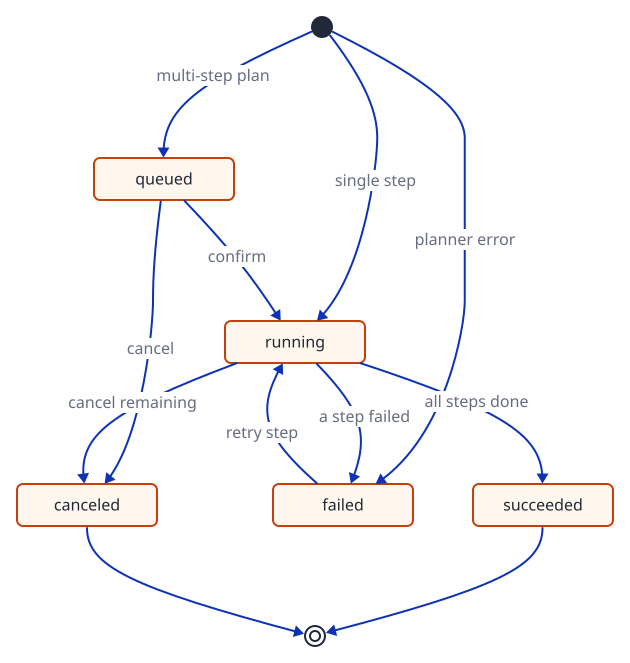

# Lumen — Agentic Picture Editing

<p align="center">
  
  
  
  
  
  
  
  
</p>

> A tool-calling agent that edits product photos from one sentence. An LLM planner chooses from 22 editing tools whose schemas are generated from the same Pydantic models the UI uses; the server validates every plan, orders it by its dependencies, and waits for the user to confirm before anything runs. Image work runs on a separate ARQ worker with live progress over SSE, local ONNX models handle cut-outs, click-to-select, and text layers, and gpt-image-2 handles generation and AI edits. FastAPI with async SQLAlchemy on the back, React 19 + Konva on the front.

## Try it live

**<https://lumen.zxuhan.me/>**

Sign up with any username (3–32 letters, digits, or underscores) and a password of at least 6 characters, then type an instruction such as *"remove the background and put the mug on a marble counter"* into the chat.

---

## Architecture

<p align="center">
  
</p>

An instruction travels through two processes. The **API** builds a summary of the canvas, asks the planner for tool calls, validates the plan, and stores it as an agent turn. Each step then becomes a **tool run** on the Redis-backed ARQ queue, where the **worker** executes it: calling gpt-image-2, running local models, compositing layers, and writing results to object storage. Progress travels back over Redis pub/sub to an SSE stream, so the browser sees every step as it happens, even though planning and execution live in different processes. Images never pass through the API on the way out; the browser loads them directly from storage through short-lived signed URLs.

---

## The agent

| # | Stage | Implementation notes | I/O |
|---|---|---|---|
| 1 | **Canvas context** (`services/agent.describe`) | Summarizes what the model needs to know and nothing else: canvas size, each layer's id, name, kind, and visibility, plus the current selection. Injected into the system prompt as `Current canvas`. | Session → text summary |
| 2 | **Planner** (`agent/llm.py`, `agent/graph.py`) | `ChatOpenAI.bind_tools` with all 22 tool schemas, generated from each tool's Pydantic model via `convert_to_openai_function`; parameters the agent must not set (seeds, reference images) are stripped. A LangGraph `StateGraph` runs `plan → verify`. The system prompt encodes the domain rules: layers and selections are independent, one step per layer, which tool recolors and which only adjusts. | Instruction + canvas → tool calls |
| 3 | **Verifier** (`agent/plan.py`) | Plans are never executed as returned. Unknown tools are rejected, every parameter set is validated against the same Pydantic model the toolbar uses, each step depends on the previous one unless the model says otherwise, references to missing steps and dependency cycles raise `PlanError`, and plans are capped at 8 steps. | Tool calls → validated steps with `depends_on` |
| 4 | **Human in the loop** (`plan.needs_confirm`, `services/agent`) | Single steps start immediately; multi-step plans wait on a plan card where the user confirms, cancels the remaining steps, or retries a failed one. An active selection is pinned to region tools (`_pin_selection`), so the plan edits what the user actually selected. | Validated plan → confirmed plan |
| 5 | **Executor** (`plan.ready`, `continue_plan`, `tasks/tools.run_tool`) | `ready()` picks the steps whose dependencies have succeeded and enqueues each as a `ToolRun`. When a run finishes, `continue_plan` advances the plan and `settle()` derives the turn's outcome, so plans make progress without a long-lived coroutine. | Steps → tool runs on the worker |
| 6 | **Tool registry** (`tools/`) | Every tool is one `ToolSpec`: a Pydantic parameter model, a label, a description written for the model, and an executor. The toolbar and the agent invoke the same specs, so a tool is defined once and both sides stay in sync. | `ToolSpec` → schema, validation, execution |

### Tool catalogue

| Group | Tools | Runs on |
|---|---|---|
| Generation | `generate_image`, `generate_marketing` | gpt-image-2 |
| AI edits | `replace_background`, `expand_canvas`, `upscale_image`, `erase_region`, `replace_region` | gpt-image-2, composited back locally |
| Local vision | `remove_background` (rembg), `split_layers` (rembg + RapidOCR, with the hole repaired by gpt-image-2), `promote_object_to_layer` | ONNX models on the worker |
| Pixel operations | `adjust_image` (11 parameters), `crop_canvas`, `prepare_delivery_sizes` (1:1 / 4:5 / 9:16 without cropping the subject) | Pillow |
| Layer operations | `flip_layer`, `rotate_layer`, `scale_layer`, `move_layer`, `reorder_layer`, `set_layer_opacity`, `set_layer_visible`, `set_layer_text` | Layer document |
| Batch | `batch_process`: one operation across many images | Worker |

---

## Turn and run lifecycle

<p align="center">
  
</p>

Agent turns and tool runs share one `RunStatus` enum with an explicit `is_terminal` property. A planner failure fails the turn visibly instead of pretending to succeed, and cancelling a plan also cancels its queued tool runs, so nothing runs after the user has said stop.

---

## Other implementation highlights

### Live progress over SSE

- Every tool run reports progress through `runs.report`, which persists it and publishes it on a per-run Redis channel (`events.publish`).
- `/events/runs/{id}` subscribes to that channel and streams it to the browser, which works no matter which process does the work.
- The frontend smooths the raw percentages (`useSmoothedProgress`), so long model calls don't look frozen.

### Image pipeline

- **Provider abstraction:** `providers/` has a deterministic `mock` provider, used by the tests and for free local runs, and an `openai` provider. Switching is one setting.
- **Size handling:** gpt-image-2 renders exact sizes (edges in multiples of 16, ratio up to 3:1). For fixed-size models the input is padded to a supported ratio and the result cropped back, so odd aspect ratios are never stretched.
- **Outpainting:** `expand_canvas` centers the original on a grey border and asks the model to paint only the border.
- **Masked compositing:** region edits put the model's output back through the selection mask (`edits/mask.apply_masked`), so pixels outside the selection stay byte-for-byte untouched.
- **Layer documents:** stored as JSONB with per-layer transforms, opacity, visibility, and editable text layers; `edits/render.flatten` composites them for export.
- **Click-to-select:** SAM caches the image embedding, so after the first click only the lightweight decoder runs.

### Testing and evaluation

- **175 tests**, mostly integration tests against real PostgreSQL, Redis, and MinIO. The LLM and image provider are replaced by a fake planner, the mock provider, and httpx mock transports, so the suite costs nothing to run.
- **`app/eval`** is a regression harness for the image pipeline: each case names a task, an input, and an expected output, and is scored by alpha IoU, PSNR, or MAE against per-case thresholds (`uv run python -m app.eval <dataset>`).
- **CI** (GitHub Actions) runs Ruff and the backend tests against service containers, lints and builds the frontend, and deploys `main` over SSH when everything passes.

### Auth and storage

- JWT (HS256) in an httpOnly cookie, marked Secure in production; passwords hashed with bcrypt.
- Image assets live in S3-compatible storage and reach the browser only through short-lived signed URLs: MinIO in development, Cloudflare R2 in production.

---

## Tech stack

| Layer    | Stack |
|----------|-------|
| Backend  | Python 3.13 · FastAPI 0.141 · SQLAlchemy 2.0 (async, asyncpg) · Alembic · ARQ · Pydantic 2 · LangGraph 1.2 · LangChain (core + OpenAI) · boto3 · Pillow · OpenCV |
| AI       | OpenAI gpt-5-mini (planner, tool calling) and gpt-image-2 (generation and edits) · local ONNX models: rembg, SAM ViT-B (quantized), RapidOCR |
| Storage  | PostgreSQL 17 · Redis 7 (job queue and pub/sub) · Cloudflare R2 / MinIO (S3 API) |
| Frontend | React 19 · TypeScript 6 · Vite 8 · Konva 10 + react-konva · TanStack Query 5 · Zustand 5 · React Router 7 · Tailwind CSS 4 |
| Infra    | Multi-stage Docker build · Docker Compose profiles · Caddy (automatic HTTPS) · GitHub Actions CI/CD |

---

## Quickstart

### Prerequisites

- **Docker Desktop** (or Docker Engine + Compose v2)
- **Python 3.13+** with [uv](https://docs.astral.sh/uv/), and **Node 20+**
- An **OpenAI API key** (optional): without one, images are placeholders and the chat is off

### Run locally

```bash
git clone https://github.com/zxuhan/lumen.git
cd lumen
cp .env.example .env
# Set OPENAI_API_KEY and IMAGE_PROVIDER=openai for real AI; the defaults run free in mock mode
docker compose up -d                                # PostgreSQL, Redis, MinIO

cd backend
uv sync --all-extras
uv run alembic upgrade head
uv run uvicorn app.main:app --reload --port 7302   # terminal 1: API
uv run arq app.worker.WorkerSettings               # terminal 2: worker

cd frontend && npm install && npm run dev          # terminal 3, from the repo root: frontend
```

| Service       | URL                                       |
|---------------|-------------------------------------------|
| Frontend      | <http://localhost:7301>                   |
| API health    | <http://localhost:7302/api/health>        |
| API docs      | <http://localhost:7302/api/docs>          |
| MinIO console | <http://localhost:7314> (`retouch` / `retouch_dev`) |

> **Costs and first run.** Chat planning needs `OPENAI_API_KEY` even in mock mode. With `IMAGE_PROVIDER=openai`, a medium-quality image costs a few cents. The first background removal or click-to-select downloads the local models (about 1 GB). To check the key and models without the rest of the stack: `uv run python -m scripts.smoke_openai`.

### Tests

```bash
cd backend
uv run pytest        # needs the Docker services above; no API calls
```

---

## Deployment

The `Dockerfile` builds the frontend into the backend image, which serves both from one origin. Caddy terminates HTTPS, images live in Cloudflare R2, and PostgreSQL, Redis, and the app listen on localhost only, so the server needs just ports 22, 80, and 443.

1. **Storage:** create an R2 bucket (pick the EU jurisdiction for EU-only storage; it can't be changed later) and an API token with **Object Read & Write** on it. Add a CORS policy, since the editor reads image pixels on a canvas:

   ```json
   [{ "AllowedOrigins": ["https://your-domain"], "AllowedMethods": ["GET", "HEAD"], "MaxAgeSeconds": 3600 }]
   ```

2. **Domain:** point an `A` record at the server. Caddy requests the certificate on first start.

3. **Server** (Ubuntu), once. Add swap, because the click-to-select and background-removal models need more than 4 GB of RAM at their peak:

   ```bash
   curl -fsSL https://get.docker.com | sudo sh && sudo usermod -aG docker $USER   # log in again afterwards
   sudo fallocate -l 8G /swapfile && sudo chmod 600 /swapfile && sudo mkswap /swapfile && sudo swapon /swapfile
   echo '/swapfile none swap sw 0 0' | sudo tee -a /etc/fstab
   git clone <repo-url> ~/lumen && cd ~/lumen
   cp .env.example .env
   # Set: APP_ENV=production, DOMAIN, JWT_SECRET (openssl rand -hex 32), IMAGE_PROVIDER=openai, OPENAI_API_KEY,
   # S3_ENDPOINT=https://<account-id>.r2.cloudflarestorage.com (EU: <account-id>.eu.r2.cloudflarestorage.com),
   # S3_REGION=auto, S3_BUCKET, S3_ACCESS_KEY, S3_SECRET_KEY
   ```

4. **First deploy:**

   ```bash
   docker compose --profile deploy build app worker
   docker compose --profile deploy run --rm app alembic upgrade head
   docker compose --profile deploy up -d app worker caddy
   ```

5. **Continuous deployment:** `.github/workflows/ci.yml` repeats step 4 after `git pull` whenever `main` passes CI. Add these repository secrets:

   | Secret | Value |
   |---|---|
   | `DEPLOY_HOST` | The server's IP or domain |
   | `DEPLOY_USER` | The SSH user that owns `~/lumen` |
   | `DEPLOY_SSH_KEY` | A private key made for CI, whose public key is in the server's `~/.ssh/authorized_keys` |
   | `DEPLOY_KNOWN_HOSTS` | The output of `ssh-keyscan <server>` |

   For a private repository, the server also needs read access to pull, for example a read-only deploy key.

---

## Project layout

```
backend/
├── app/
│   ├── agent/            # llm.py (tool binding) · graph.py (plan → verify) · plan.py (validation, ordering)
│   ├── tools/            # 22 ToolSpecs shared by the toolbar and the agent
│   ├── services/         # agent turns, tool runs, sessions, assets, batches, exports
│   ├── edits/            # pixel pipeline: masks, layer rendering, SAM, OCR, layer splitting
│   ├── providers/        # image providers: mock · openai_images
│   ├── routers/          # REST and SSE endpoints
│   ├── models/ schemas/  # SQLAlchemy models · Pydantic schemas
│   ├── tasks/ worker.py  # ARQ worker and the tool-run task
│   ├── eval/             # image-pipeline regression harness
│   └── events.py · storage.py · security.py · config.py
├── migrations/           # Alembic
├── scripts/              # smoke and end-to-end checks
└── tests/
frontend/src/
├── components/editor/    # canvas stage, toolbar, layer panel, chat
└── pages/ hooks/ stores/ lib/ api/
.github/workflows/ci.yml  # CI and deploy
docs/                     # D2 diagram sources and rendered SVGs
Caddyfile · Dockerfile · docker-compose.yml
```
