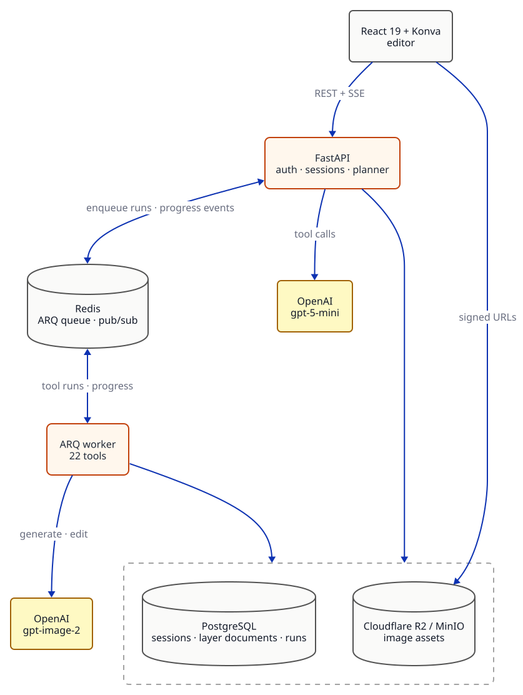
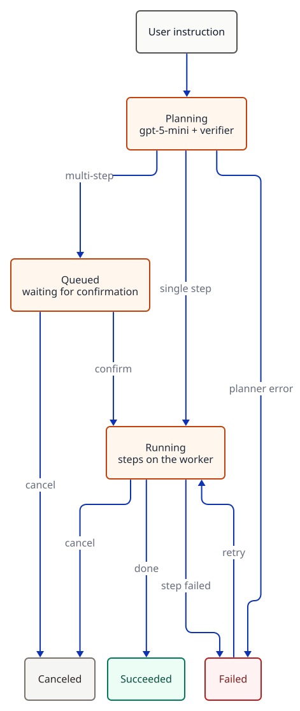

# Lumen — Agentic Picture Editing

<p align="center">
  
  
  
  
  
  
  
  
</p>

> Lumen is an AI editor for product photos. Type what you want, like *"remove the background and put the mug on a marble counter"*, and an agent plans the edit, shows you the steps, and applies them to a layered canvas you can keep editing by hand.

## Try it live

**<https://lumen.zxuhan.me/>**

Log in with the demo account **`demo`** / **`lumen-demo`**, or sign up with your own username.

---

## Architecture

<p align="center">
  
</p>

The API plans each instruction and queues its steps. A separate ARQ worker runs them and publishes progress to Redis, which the API streams to the browser over SSE.

---

## The agent

The agent uses the same 22 tools as the toolbar: generation and AI edits with gpt-image-2, background removal, click-to-select and text layers with local ONNX models, plus layer and pixel operations.

| Stage | What it does |
|---|---|
| **Context** (`services/agent.py`) | Gives the planner only what it needs: canvas size, layers, and the current selection. |
| **Planner** (`agent/llm.py`, `agent/graph.py`) | gpt-5-mini with all 22 tool schemas bound, generated from the same Pydantic models the toolbar uses. Runs as a LangGraph `plan → verify` graph. |
| **Verifier** (`agent/plan.py`) | Rejects unknown tools and invalid parameters, orders steps by their dependencies, rejects cycles, and caps plans at 8 steps. |
| **Executor** (`tasks/tools.py`) | Queues each ready step as a tool run on the worker and advances the plan as runs finish. |

---

## Agent lifecycle

<p align="center">
  
</p>

Single steps run right away; multi-step plans wait for the user to confirm. A failed step can be retried, and cancelling stops every step that hasn't started.

---

## Highlights

- **Edits stay inside the selection:** region edits are composited back through the selection mask, so pixels outside it never change.
- **Any aspect ratio:** gpt-image-2 renders exact sizes, and fixed-size models get a padded input that is cropped back, so nothing is stretched. Outpainting paints only the new border.
- **Fast click-to-select:** SAM caches the image embedding, so later clicks only run the small decoder.
- **Tests that cost nothing:** 175 tests, mostly against real PostgreSQL, Redis, and MinIO, with a fake planner and a mock image provider. `app/eval` scores the image pipeline by alpha IoU, PSNR, or MAE.

---

## Tech stack

| Layer    | Stack |
|----------|-------|
| Backend  | Python 3.13 · FastAPI 0.141 · SQLAlchemy 2.0 (async, asyncpg) · Alembic · ARQ · Pydantic 2 · LangGraph 1.2 · LangChain (core + OpenAI) · boto3 · Pillow · OpenCV |
| AI       | OpenAI gpt-5-mini (planner, tool calling) and gpt-image-2 (generation and edits) · local ONNX models: rembg, SAM ViT-B (quantized), RapidOCR |
| Storage  | PostgreSQL 17 · Redis 7 (job queue and pub/sub) · Cloudflare R2 / MinIO (S3 API) |
| Frontend | React 19 · TypeScript 6 · Vite 8 · Konva 10 + react-konva · TanStack Query 5 · Zustand 5 · React Router 7 · Tailwind CSS 4 |
| Infra    | Multi-stage Docker build · Docker Compose profiles · Caddy (automatic HTTPS) · GitHub Actions CI/CD |

---

## Quickstart

### Prerequisites

- **Docker Desktop** (or Docker Engine + Compose v2)
- **Python 3.13+** with [uv](https://docs.astral.sh/uv/), and **Node 20+**
- An **OpenAI API key** (optional): without one, images are placeholders and the chat is off

### Run locally

```bash
git clone https://github.com/zxuhan/lumen.git
cd lumen
cp .env.example .env
# Set OPENAI_API_KEY and IMAGE_PROVIDER=openai for real AI; the defaults run free in mock mode
docker compose up -d                                # PostgreSQL, Redis, MinIO

cd backend
uv sync --all-extras
uv run alembic upgrade head
uv run uvicorn app.main:app --reload --port 7302   # terminal 1: API
uv run arq app.worker.WorkerSettings               # terminal 2: worker

cd frontend && npm install && npm run dev          # terminal 3, from the repo root: frontend
```

| Service       | URL                                       |
|---------------|-------------------------------------------|
| Frontend      | <http://localhost:7301>                   |
| API health    | <http://localhost:7302/api/health>        |
| API docs      | <http://localhost:7302/api/docs>          |
| MinIO console | <http://localhost:7314> (`retouch` / `retouch_dev`) |

> **Costs and first run.** Chat planning needs `OPENAI_API_KEY` even in mock mode. With `IMAGE_PROVIDER=openai`, a medium-quality image costs a few cents. The first background removal or click-to-select downloads the local models (about 1 GB). To check the key and models without the rest of the stack: `uv run python -m scripts.smoke_openai`.

### Tests

```bash
cd backend
uv run pytest        # needs the Docker services above; no API calls
```

---

## Project layout

```
backend/
├── app/
│   ├── agent/            # llm.py (tool binding) · graph.py (plan → verify) · plan.py (validation, ordering)
│   ├── tools/            # 22 ToolSpecs shared by the toolbar and the agent
│   ├── services/         # agent turns, tool runs, sessions, assets, batches, exports
│   ├── edits/            # pixel pipeline: masks, layer rendering, SAM, OCR, layer splitting
│   ├── providers/        # image providers: mock · openai_images
│   ├── routers/          # REST and SSE endpoints
│   ├── models/ schemas/  # SQLAlchemy models · Pydantic schemas
│   ├── tasks/ worker.py  # ARQ worker and the tool-run task
│   ├── eval/             # image-pipeline regression harness
│   └── events.py · storage.py · security.py · config.py
├── migrations/           # Alembic
├── scripts/              # smoke and end-to-end checks
└── tests/
frontend/src/
├── components/editor/    # canvas stage, toolbar, layer panel, chat
└── pages/ hooks/ stores/ lib/ api/
.github/workflows/ci.yml  # CI and deploy
docs/                     # D2 diagram sources and rendered SVGs
Caddyfile · Dockerfile · docker-compose.yml
```
